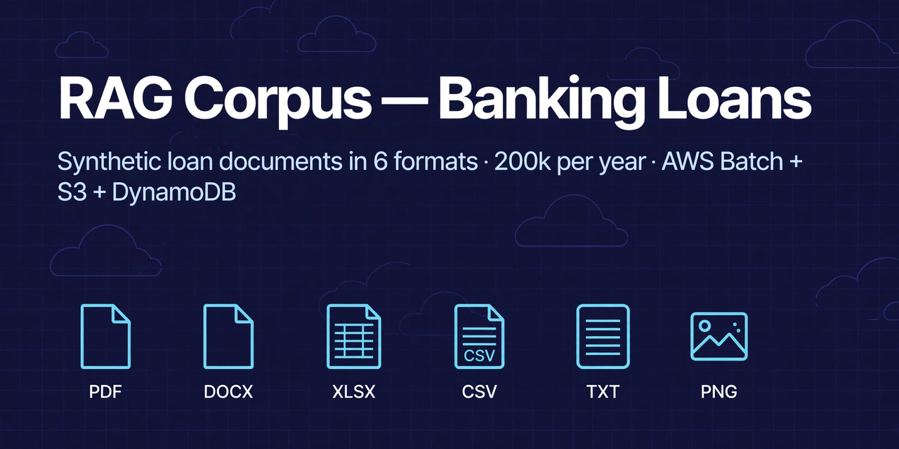

# RAG Corpus — Banking Loans



> **Purpose:** generate a large, realistic, *unique* synthetic corpus of
> banking-loan documents in six formats, so a RAG system can be built,
> tested, and measured against known ground truth.
>
> **Scale:** 200,000 records per annum, last 10 years, per document type.
> That is 2,000,000 records per format and 12,000,000 files in total
> (2M × 6 formats). Start small — 1,000 records — and scale up.
>
> **Status:** generator + uniqueness checker are working locally.
> AWS infra is defined in CloudFormation and provisioned manually.
> Nothing is deployed yet — no AWS account is connected to this repo.
> The work plan is tracked in GitHub Issues: 5 milestones, 9 epics,
> 33 features, 85 stories (127 issues), with topical labels
> (`aws`, `s3`, `datagen-wf`, `infra-setup`, `infra-destroy`, …) —
> see [GITHUB_ISSUES.md](GITHUB_ISSUES.md).

---

## Table of contents

1. [What this is — and what it is not](#1-what-this-is--and-what-it-is-not)
2. [Quick start — local, no AWS](#2-quick-start--local-no-aws)
3. [Repo layout](#3-repo-layout)
4. [The corpus — what a record looks like](#4-the-corpus--what-a-record-looks-like)
5. [Uniqueness — the rule that makes RAG useful](#5-uniqueness--the-rule-that-makes-rag-useful)
6. [Provisioning AWS infra (manual)](#6-provisioning-aws-infra-manual)
7. [Generating data (manual, per format, per year)](#7-generating-data-manual-per-format-per-year)
8. [GitHub Actions secrets](#8-github-actions-secrets)
9. [How a run works, end to end](#9-how-a-run-works-end-to-end)
10. [Deduplication](#10-deduplication)
11. [Testing](#11-testing)
12. [Troubleshooting](#12-troubleshooting)
13. [Working in Cursor](#13-working-in-cursor)
14. [Related docs](#14-related-docs)

---

## 1. What this is — and what it is not

**This is:**

- A synthetic data *generator* for banking loans. One loan record is
  rendered in six formats — PDF, DOCX, XLSX, CSV, TXT, PNG — with the
  same question and answer in every format, so retrieval can be compared
  across parsers with known ground truth.
- A professional AWS pipeline to generate that corpus at scale:
  GitHub → CloudFormation → Step Functions → Planner Lambda → SQS →
  AWS Batch → S3 + DynamoDB.
- A corpus for *learning and measuring RAG*: you know exactly which
  document holds each answer, so you can measure recall, precision,
  and grounding instead of guessing.

**This is not:**

- A RAG system itself. There is no chunking, embedding, vector store,
  or retrieval in this repo. Those are a later stage. Chunking is
  deliberately out of scope here — see `DESIGN.md`.
- Real customer data. All names, loan IDs, branches, amounts, and
  dates are fictional / synthetic. Do not put real customer data
  through this generator.
- A policy corpus. The generator makes *customer-like loan records*.
  Policy documents (rate policy, eligibility rules, MITC, versioned
  over time) are a separate, small corpus — see `DESIGN.md §3`.

**Audiences:** the RAG system answers questions for banking loan
customers, customer support, and partner channels.

---

## 2. Quick start — local, no AWS

Requirements: Python 3.12+. No other dependencies are needed for the
generator itself. Pillow is optional (used for PNG text cards; without
it a plain PNG fallback is written).

```bash
# 1. Clone the repo (this is the code you commit to GitHub)
git clone <your-repo-url> rag-corpus
cd rag-corpus

# 2. Generate 10 records in all six formats
python3 Middleware/Workflows/Datagen/src/generator/generator.py --count 10 --out ./corpus --year 2024

# 3. Look at one
cat corpus/txt/loan_0000000_*.txt

# 4. Measure description uniqueness on 200 records
python3 Middleware/Workflows/Datagen/uniqueness_check.py --count 200 --seed 7
```

Expected output for step 2:

```
Done: 10 records x 6 formats = 60 files in ./corpus
Uniqueness: 0 description(s) rejected/regenerated for overlap > 0.65
Manifest: ./corpus/manifest.jsonl
```

### Generator CLI — full options

```
python3 Middleware/Workflows/Datagen/src/generator/generator.py \
  --count 1000 \            # records (documents) per format
  --out ./corpus \          # output directory
  --seed 7 \                # deterministic generation
  --formats pdf,docx,xlsx,csv,txt,png \   # subset, comma-separated
  --start 0 \               # starting index (sharding / resume)
  --year 2024 \             # loan year; start dates fall inside it
  --max-overlap 0.65        # reject descriptions above this wording overlap
```

Notes:

- `--year` is what drives the S3 `yyyy/mm/dd` partition in AWS runs.
  Without it, start dates are spread over 2023–2025.
- `--max-overlap 0` disables the uniqueness reject loop.
- The generator is deterministic for a given `--seed` + `--start` +
  `--year`: re-running the same command reproduces the same files.

---

## 3. Repo layout

This repo is organised as a platform, not a single app:

```
.
├── README.md, ARCHITECTURE.md, DESIGN.md, GITHUB_ISSUES.md   # docs — start here
├── .github/workflows/      # GitHub Actions (must live at repo root)
│   ├── ci.yml, create-issues.yml, close-issues.yml
│   ├── aws-001-provision-infra.yml, aws-002-generate.yml, aws-003…aws-008-generate-<format>.yml
│   └── aws-010-destroy-infra.yml, aws-009-delete-data.yml
├── scripts/                # repo tooling (issue creation / closing)
├── Middleware/             # server-side apps
│   ├── Workflows/
│   │   └── Datagen/        # THIS APP — synthetic loan-data generation (ETL)
│   │       ├── Dockerfile, requirements.txt   # its own Batch worker image
│   │       ├── src/
│   │       │   ├── generator/generator.py     # SHARED bottom layer — generator
│   │       │   ├── planner/planner.py         # SHARED — Lambda: SQS shards
│   │       │   └── worker/batch_worker.py     # SHARED — Batch worker
│   │       ├── infra/
│   │       │   ├── cloudformation/            # storage / compute / orchestration
│   │       │   ├── stepfunctions/             # state-machine.json
│   │       │   └── archive-terraform/         # superseded — reference only
│   │       ├── scripts/    # run_local.sh, enqueue_shards.py (DLQ replay)
│   │       ├── tests/      # generator unit tests
│   │       ├── deployments/  # how the Datagen image + stacks are deployed
│   │       ├── uniqueness_check.py, uniqueness_report.md
│   │       └── README.md
│   └── API-Services/       # FUTURE — loan / RAG query APIs (not built yet)
└── Portals/
    └── Loan-Advisor/       # FUTURE — customer-facing Angular app (not built yet)
```

Each app under `Middleware/` and `Portals/` gets **its own Docker
image and its own deployments** — Datagen's image (`<project>-worker`)
is built from `Middleware/Workflows/Datagen/Dockerfile` with that
folder as the build context. A future API service gets its own
Dockerfile the same way; it never shares Datagen's image.

**Layering rule — read this before changing code:**

- **Top layer (thin, per format):** the six `aws-003…aws-008-generate-<format>.yml`
  workflows. Each one only names its format and passes `count`,
  `year`, `shard_size`, `seed` through. Do not put logic here.
- **Middle layer (shared orchestration):** `aws-002-generate.yml`,
  Step Functions, Planner Lambda, SQS. Format-agnostic.
- **Bottom layer (shared, reused):** `Middleware/Workflows/Datagen/src/generator/generator.py`,
  `Middleware/Workflows/Datagen/src/worker/batch_worker.py`, the Batch job definition, S3, DynamoDB.
  This is where all real logic lives. Change it once, all six formats
  get the change.

If you are adding a seventh format, you add one thin workflow file
plus one writer in `generator.py` — nothing else changes.

---

## 4. The corpus — what a record looks like

One record = one loan, one question, one answer. The same record is
rendered in all six formats.

**Fields (per record):**

| Field | Example | Notes |
|---|---|---|
| `loan_id` | `711097000000` | Fictional, deterministic from seed + index |
| `name` | `Arjun Kulkarni` | Fictional |
| `loan_type` | `Business Loan` | Home / Personal / Business / Auto / Education / Gold / MSME |
| `purpose` | `equipment purchase` | Depends on loan type |
| `amount` | `Rs. 39,327,000` | Log-uniform within the loan type's range |
| `rate` | `11.37%` | Within the loan type's range |
| `tenure` | `12 months` | From the loan type's tenure list |
| `emi` | `Rs. 3,482,576.47` | Computed from amount / rate / tenure |
| `credit_score` | `761` | 650–850 |
| `status` | `Approved` | Approved / Disbursed / Under Review |
| `branch` | `Mumbai-Andheri` | Fictional branch |
| `start_date` | `2024-03-25` | Inside `--year` when given; drives the S3 partition |
| `channel` | `partners` | `loan customers` / `customer support` / `partners` |
| `question` / `answer` | see below | One Q&A pair per record |

**Formats:**

| Format | Content | Why it exists |
|---|---|---|
| PDF | Loan summary sheet | Tests PDF text extraction |
| DOCX | Loan application summary | Tests Word parsing |
| XLSX | Loan fields + 12-month EMI schedule | Tests spreadsheet parsing |
| CSV | One loan record as a table row | Tests tabular ingestion |
| TXT | FAQ / support answer text | Plain-text baseline |
| PNG | Loan summary card rendered as an image | Tests OCR in the RAG pipeline |

**Manifest:** every run writes `manifest.jsonl` (local) and DynamoDB
rows (AWS). Each row is ground truth: `doc_id`, `format`, `s3_key`,
`loan_id`, `loan_type`, `channel`, `question`, `answer`, `run_id`,
`shard_id`, `year`, `month`, `day`.

**S3 key layout (AWS):**

```
s3://<bucket>/raw/<format>/year=2024/month=03/day=12/loan_0000000_711097000000.pdf
s3://<bucket>/manifests/<run_id>/<shard_id>.jsonl
s3://<bucket>/markers/<run_id>/<shard_id>.done
```

The partition is by **loan start date**, not generation date.

---

## 5. Uniqueness — the rule that makes RAG useful

**Why it matters:** if descriptions overlap too much, retrieval cannot
tell one loan from another, the LLM mixes numbers from different
loans, and accuracy scores are meaningless. Uniqueness is a
precondition for RAG, not polish. See `DESIGN.md §5` for the full
reasoning and `uniqueness_report.md` (goal files) for numbers.

**How it is measured:** wording-only Jaccard similarity on word
5-gram shingles, digits stripped. Two descriptions that differ only
in numbers score near 1.0.

**Measured results (200 records, seed 7):**

| Metric | v1 (one template) | v2 (current) |
|---|---|---|
| Wording-only mean | 0.246 | **0.128** |
| Wording-only, same loan-type mean | 0.333 | **0.167** |
| Same-type pairs > 0.5 | 25.0% | **1.5%** |
| Max | 0.882 | **0.701** |

**How v2 achieves it:**

1. Four paraphrase variants per answer topic, chosen per record.
2. Three layouts (standard, question-first, status-first) and varied
   field labels (`Amount` / `Sanctioned amount`, `EMI` / `Monthly instalment`).
3. One contextual sentence per record, from channel / purpose / status.
4. Generate → measure → reject loop: `--max-overlap 0.65` (default).
   A description above that threshold is regenerated with a different
   variant/layout, up to 5 attempts.

**Run the checker before scaling:**

```bash
python3 Middleware/Workflows/Datagen/uniqueness_check.py --count 200 --seed 7
```

The remaining overlap is mostly unavoidable domain vocabulary
(interest rate, EMI, tenure). 100% unique text is not achievable —
or desirable — in a single domain.

---

## 6. Provisioning AWS infra (manual)

**Prerequisite:** set the GitHub Actions secrets in §8 first.

In GitHub: **Actions → AWS-001 Provision Infra → Run workflow.**

Inputs: `project` (default `rag-corpus`), `max_vcpus` (default `64`),
`vpc_mode` (`create-new` or `use-existing`, default `create-new`) —
see §8 for the VPC choice.

What it does, in order:

1. Packages `Middleware/Workflows/Datagen/src/planner/` as `planner.zip` and uploads it to S3.
2. Deploys `Middleware/Workflows/Datagen/infra/cloudformation/storage.yaml` as stack
   `<project>-storage` — S3 bucket, DynamoDB manifest + dedup tables,
   SQS FIFO + DLQ.
3. Builds the worker Docker image, pushes it to ECR.
4. Deploys `Middleware/Workflows/Datagen/infra/cloudformation/compute.yaml` as stack
   `<project>-compute` — ECR, Batch Fargate Spot compute environment,
   job queue, job definition. VPC, subnets, and security groups come
   from GitHub secrets as CloudFormation parameters.
5. Deploys `Middleware/Workflows/Datagen/infra/cloudformation/orchestration.yaml` as stack
   `<project>-orchestration` — Planner Lambda, Step Functions state
   machine, DLQ CloudWatch alarm.

Re-run the same workflow whenever infra changes. CloudFormation
updates the stacks in place; it does not recreate the bucket or tables.

**Do not** provision infra from a local machine with long-lived keys
as a habit — the workflow is the supported path. Local `aws
cloudformation deploy` with the same templates works for debugging,
but keep the workflow as the source of truth.

---

## 7. Generating data (manual, per format, per year)

**Prerequisite:** infra provisioned (§6).

In GitHub: **Actions → AWS-003 Generate PDF → Run workflow** (or docx, xlsx,
csv, txt, png).

Inputs:

| Input | Example | Meaning |
|---|---|---|
| `count` | `200000` | Records to generate for this format + year |
| `year` | `2024` | Loan year (S3 partition) |
| `shard_size` | `10000` | Records per shard (200k → 20 shards) |
| `seed` | `7` | Deterministic generation |

That starts a Step Functions execution named
`<year>-<format>-<timestamp>`, e.g. `2024-pdf-20261112-083000`.

**Volume math:**

- 200,000 records/year × 10 years (2016–2025) = 2,000,000 records per format
- × 6 formats = 12,000,000 files
- Per format per year: 20 shards of 10,000 records
- Per format, all years: 200 shards
- All formats, all years: 60 manual runs (6 formats × 10 years)

Each run is independent and resumable. If a run fails halfway, re-run
only that format + year — finished shards are skipped via their
`.done` markers, and finished files are overwritten identically.

**Start small:** run `count: 1000`, `year: 2024` for one format first.
Check S3 and DynamoDB counts, then scale to 200,000.

---

## 8. GitHub Actions secrets

Set in the repo: **Settings → Secrets and variables → Actions.**
Never hard-code these in the repo.

| Secret | Example | Used by |
|---|---|---|
| `AWS_ACCESS_KEY_ID` | `AKIA…` | All workflows (AWS auth) |
| `AWS_SECRET_ACCESS_KEY` | `…` | All workflows |
| `AWS_REGION` | `ap-south-1` | All workflows |
| `AWS_ACCOUNT_ID` | `123456789012` | Provision + generate |
| `PROJECT` | `rag-corpus` | All workflows |
| `VPC_ID` | `vpc-0123456789abcdef0` | Provision, only if `vpc_mode=use-existing` |
| `SUBNET_IDS` | `subnet-aaa,subnet-bbb` | Provision, only if `vpc_mode=use-existing` |
| `SECURITY_GROUP_IDS` | `sg-0123456789abcdef0` | Provision, only if `vpc_mode=use-existing` |

An example parameter file is at
`Middleware/Workflows/Datagen/infra/cloudformation/parameters/prod.json.example` — copy it, fill
in your values, and do **not** commit the filled-in copy.

### VPC: let AWS-001 create one, or use an existing one

When you run **AWS-001 Provision Infra** you pick `vpc_mode`:

- **`create-new` (default):** AWS-001 first deploys
  `infra/cloudformation/vpc.yaml` (`$PROJECT-vpc` stack: a VPC,
  two private subnets for Batch, a NAT gateway, a security group)
  and uses its outputs — you configure nothing: no VPC, subnet or
  security group secrets needed. The NAT gateway costs ~$32/month
  + data while the stack exists; **AWS-010 Destroy Infra** deletes
  it. This is the normal path when you have no VPC yet and just
  want the pipeline up.
- **`use-existing`:** only if you already have a VPC you want to
  reuse. The compute stack then uses `VPC_ID` / `SUBNET_IDS` /
  `SECURITY_GROUP_IDS` from the secrets above — or the `vpc_id` /
  `subnet_ids` / `security_group_ids` run inputs, which win over
  the secrets. If none are set, the run fails and tells you which
  secret or input is missing.

AWS credentials (`AWS_ACCESS_KEY_ID`, `AWS_SECRET_ACCESS_KEY`,
`AWS_REGION`, `AWS_ACCOUNT_ID`) always come from the secrets
above — configure them later, before the first AWS-001 run. Until
then the run fails at the first step naming the missing secret.

---

## 9. How a run works, end to end

```
Manual trigger (GitHub Actions, per format + year)
  │
  ▼
Step Functions  (state machine: PlanShards → SubmitBatchWorkers)
  │  input: {total_per_format, shard_size, formats: ["pdf"], year, seed, run_id}
  ▼
Planner Lambda  (splits 200k into 20 shards of 10k, enqueues to SQS)
  │
  ▼
SQS FIFO queue  (one message per shard; maxReceiveCount=3 → DLQ)
  │
  ▼
AWS Batch, Fargate Spot  (workers poll SQS, one shard at a time)
  │  for each record in the shard:
  │    generate (shared generator, deterministic seed+start+year)
  │    check wording overlap (reject/regenerate if > 0.65)
  │    render in the requested format(s)
  │    upload to S3  raw/<format>/year=YYYY/month=MM/day=DD/…
  │    upsert DynamoDB manifest + claim dedup hash
  │  write shard manifest + .done marker to S3
  │  delete the SQS message (only on full success)
  ▼
S3 + DynamoDB  (corpus + ground-truth manifest)
```

**Retry, in order:** Step Functions retry (backoff) → Batch retry
(3 attempts) → SQS redelivery (3 receives) → DLQ. A failed shard is
replayed from the DLQ with `Middleware/Workflows/Datagen/scripts/enqueue_shards.py` — never re-run
the whole year.

**Idempotency:** same seed + start + year always generates the same
records; S3 keys are deterministic; DynamoDB upserts write identical
values; shard `.done` markers make replays skip finished shards.

Full architecture detail: see `ARCHITECTURE.md`.

---

## 10. Deduplication

There are three different duplicates, and three different guards.
Do not confuse them — see `DESIGN.md §6`.

1. **Same shard retried** — guarded by the S3 `.done` marker and
   deterministic S3 keys.
2. **Same SQS message delivered twice** — guarded by SQS FIFO
   deduplication (`run_id + shard_id`) and by idempotent writes.
3. **Same unique business fields under a different ID** — guarded by
   the **dedup table**, not by the manifest PK. The dedup table's PK
   is `natural_hash = SHA256(normalised unique fields)`, claimed with
   `ConditionExpression attribute_not_exists(natural_hash)`. A GSI
   does not enforce uniqueness — only a PK does.

What counts as "unique fields" is a business decision. The current
generator uses the description's wording hash for the overlap check
(§5) and the manifest `doc_id` for lookup. If you define a business
natural key (e.g. customer + loan type + start date), add it to the
dedup table — see `DESIGN.md §6` for the exact pattern.

---

## 11. Testing

```bash
# Unit tests (generator)
python3 -m pytest Middleware/Workflows/Datagen/tests/ -q
# or, without pytest installed:
python3 - << 'PY'
import sys
sys.path.insert(0, "Middleware/Workflows/Datagen/tests"); sys.path.insert(0, "Middleware/Workflows/Datagen/src")
import test_generator
for n in dir(test_generator):
    if n.startswith("test_"):
        getattr(test_generator, n)(); print(n, "PASS")
PY

# Syntax check
python3 -m py_compile Middleware/Workflows/Datagen/src/generator/generator.py Middleware/Workflows/Datagen/src/planner/planner.py Middleware/Workflows/Datagen/src/worker/batch_worker.py

# Uniqueness check (see §5)
python3 Middleware/Workflows/Datagen/uniqueness_check.py --count 200 --seed 7

# Local generation smoke test
python3 Middleware/Workflows/Datagen/src/generator/generator.py --count 10 --out /tmp/corpus --year 2024
```

CI (`ci.yml`) runs the unit tests and py_compile on every push/PR.
The Batch worker and Planner import `boto3`, which is not installed
locally by default — that is expected; they run in the Docker image
/ Lambda runtime, where `boto3` is available.

---

## 12. Troubleshooting

| Symptom | Likely cause | Fix |
|---|---|---|
| `aws-001-provision-infra` fails on the compute stack | VPC / subnet / SG secrets are wrong or empty | Check §8 secrets; subnets must have a NAT gateway or an S3 VPC endpoint |
| Batch jobs stay `RUNNABLE` | Compute environment has no capacity, or subnets have no outbound route | Check Batch console → compute environment; check the VPC route |
| Shards land in the DLQ | Worker exception, e.g. S3/DynamoDB permission | Read CloudWatch Logs `/aws/batch/job`; fix the cause, then replay the DLQ with `Middleware/Workflows/Datagen/scripts/enqueue_shards.py` |
| Same shard runs twice | That is expected on retry — check the `.done` marker; it should skip on replay | If it re-generates, the marker write failed — check S3 permissions |
| Uniqueness check is slow | Pairwise Jaccard is O(n²) | Keep `--count` at 200 for the check; at 1M scale use MinHash/LSH in the worker, not pairwise comparison |
| `terraform` files are missing | Intentional — Terraform is archived | Use CloudFormation under `Middleware/Workflows/Datagen/infra/cloudformation/`; the old Terraform is in `Middleware/Workflows/Datagen/infra/archive-terraform/` for reference only |

---

## 13. Working in Cursor

This repo is set up to be developed in Cursor (or any AI-assisted
editor) with the docs as context:

1. **Start with these three files, in order:** `README.md` (this
   file), `ARCHITECTURE.md`, `DESIGN.md`. They are the source of
   truth for intent. Code follows them, not the other way round.
2. **Ask Cursor to change one layer at a time.** Example prompts:
   - "Add a seventh format, `parquet`, following the pattern in
     DESIGN.md §4. Add a writer, a workflow, and a test."
   - "Change the shard size default to 20,000. Update the planner,
     the workflow inputs, and ARCHITECTURE.md."
   - "Add a MinHash dedup check to the Batch worker, using the dedup
     table described in DESIGN.md §6."
3. **Do not let Cursor hard-code secrets, VPC IDs, or account IDs.**
   Those come from GitHub Secrets (§8) and CloudFormation parameters.
4. **After any generator change, re-run §11 tests + §5 uniqueness
   check.** A generator change that raises wording overlap above the
   v2 baseline (mean 0.128, same-type >0.5 at 1.5%) is a regression.
5. **Keep the layering rule (§3).** Per-format logic belongs in the
   generator writer only. Orchestration logic belongs in the planner /
   worker / Step Functions. Infra belongs in CloudFormation.

---

## 14. Related docs

- `ARCHITECTURE.md` — system architecture, AWS services, scaling,
  failure modes, cost and security.
- `DESIGN.md` — design decisions, data model, interfaces, invariants,
  uniqueness and dedup design, extensibility, open questions.
- `uniqueness_report.md` — measured before/after uniqueness numbers
  (in the goal files, alongside the generator).
